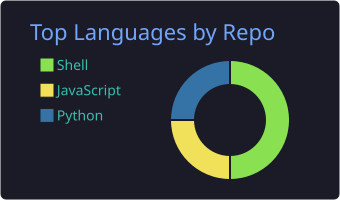
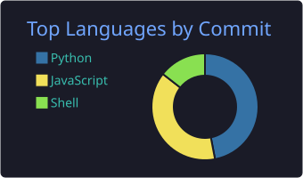
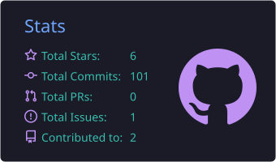
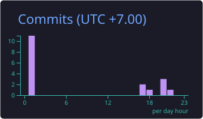

<div align="center">


<a href="https://github.com/fhudint">
  
</a>

<br/><br/>


<a href="https://github.com/fhudint?tab=followers"></a>
<a href="https://github.com/fhudint?tab=repositories"></a>

</div>

<br/>


###  About me

```console
fhudint@fedora:~$ neofetch

        OS ➜  Fedora Linux
      ROLE ➜  Developer
   FOCUSED ➜  building fun, useful things
  LEARNING ➜  something new, every single day
   OPEN TO ➜  collabs & open source
 ASK ME ON ➜  linux · web · tooling
    UPTIME ➜  ∞ (powered by coffee ☕)
```

<br clear="right"/>

<div align="center">


### ⚡ Tech I play with


<br/>


### 📊 GitHub stats








### 🐍 Contribution snake

<picture>
  <source media="(prefers-color-scheme: dark)" srcset="https://raw.githubusercontent.com/fhudint/fhudint/output/github-snake.svg" />
  <source media="(prefers-color-scheme: light)" srcset="https://raw.githubusercontent.com/fhudint/fhudint/output/github-snake-light.svg" />
  
</picture>


<br/><br/>

**✦ thanks for stopping by — have a great day! ✦**


</div>
