### $ cat about.txt

```text
os        currently fedora
role      just human being
stack     javascript · typescript · python · bash
focus     linux, web, tooling, open source
status    building useful things, one commit at a time
contact   say hi — issues and PRs are always welcome
```

### $ ls skills/


### $ git log --stat


<picture>
  <source media="(prefers-color-scheme: dark)" srcset="https://raw.githubusercontent.com/fhudint/fhudint/output/github-snake.svg" />
  <source media="(prefers-color-scheme: light)" srcset="https://raw.githubusercontent.com/fhudint/fhudint/output/github-snake-light.svg" />
  
</picture>


